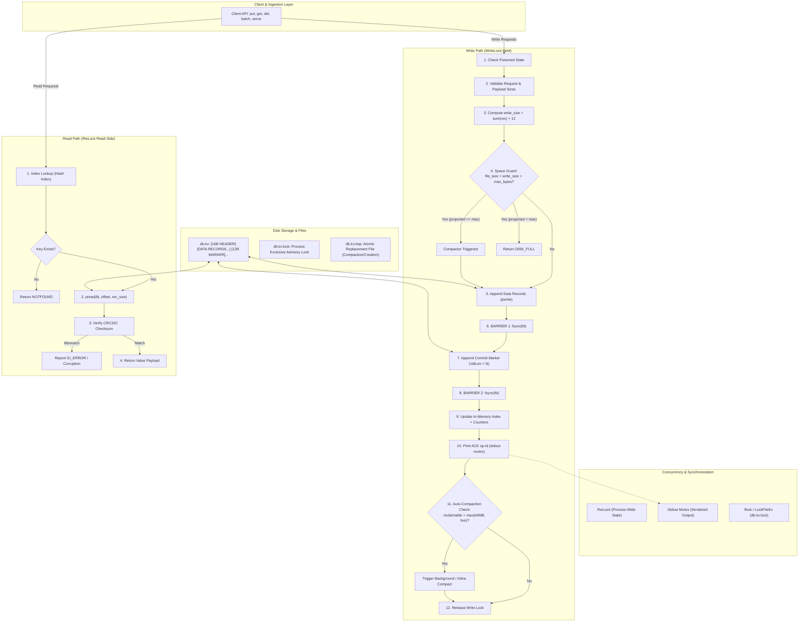

# KILL IT AND PROVE IT: ARCHITECTURE (v3.2)

Key-Value Database Storage Engine Architecture Specification.

---

## 1. Overview

* **Layout:** One authoritative data file, `db.kv`: 16-byte header + append-only log. Every commit (single operation or batch) terminates with a 12-byte commit marker.
* **Memory:** An in-memory hash index maps each live key to its record's file offset and size (`HashMap<key, {offset, rec_size, val_len}>`). Values are never cached in RAM; they are read directly from disk via `pread`.
* **Durability:** Two `fsync` barriers per commit. The in-memory index is updated only after the second barrier completes successfully, guaranteeing that memory never references data that is not durable on disk.
* **Concurrency:** A single process owns the file via an exclusive non-blocking advisory file lock (`flock` on POSIX, `LockFileEx` on Windows). Within the process, an `RWMutex` serializes writers and allows concurrent `Get()` readers. All stdout acknowledgments (`ACK`) are emitted under the write lock through a dedicated stdout mutex.
* **Recovery:** Takes the exclusive lock first, then performs a sequential scan from byte 16 staging uncommitted records until a valid commit marker is encountered. Any uncommitted data, torn record, or trailing corruption after the last valid marker is truncated and fsynced.
* **Compaction:** Writes active (live) records to `db.kv.tmp`, fsyncs the temp file, and atomically renames it over `db.kv`. On POSIX systems, the open file descriptor of the temp file seamlessly becomes the database's live descriptor without reopening.

---

## 2. Architecture Diagram



### ASCII Reference Flow

```
                 +---------------------------------------------+
  stdin / API -->| Client API: put, get, del, batch, serve     |
                 +-------+----------------------------+--------+
                         | writes                     | reads
                         v                            v
   +----------------------------------+   +----------------------+
   | WRITE PATH (WriteLock)           |   | READ PATH (RwLock    |
   | 1  reject if poisoned            |   | read side)           |
   | 2  validate request              |   | index lookup         |
   | 3  compute write_size            |   | pread at offset      |
   | 4  space guard ------------------+-+ | verify CRC32C        |
   | 5  append data records           | | +----------+-----------+
   | 6  fsync    (BARRIER 1)          | |            |
   | 7  append commit marker          | |            |
   | 8  fsync    (BARRIER 2)          | |            |
   | 9  update index + counters       | |            |
   | 10 print ACK (stdout mutex)      | |            |
   | 11 auto-compaction check         | |            |
   | 12 release lock                  | |            |
   +----------------+-----------------+ |            |
                    |                   v            |
                    |      +----------------------+  |
                    |      | DISK-FULL GUARD      |  |
                    |      | + COMPACTOR          |  |
                    |      | (same lock, sec. 8)  |  |
                    |      +----------+-----------+  |
                    v                 v              v
   +---------------------------------------------------------+
   | IN-MEMORY INDEX: HashMap<key, {offset, rec_size, len}>  |
   +----------------------------+----------------------------+
                                v
   +---------------------------------------------------------+
   | FILE db.kv:  [HEADER 16 B][records ...][MARKER 12 B]... |
   | db.kv.lock:  flock held for process lifetime            |
   | db.kv.tmp:   exists only during compaction or creation  |
   +---------------------------------------------------------+

RECOVERY (open): Phase 0 lock and setup -> Phase 1 scan and stage
                 -> Phase 2 truncate -> Phase 3 ready

Write ordering: 1 append data records, 2 fsync (barrier 1), 3 append marker,
                4 fsync (barrier 2), 5 update index, 6 print ACK, 7 release lock
```

---

## 3. On-Disk Binary Format

A valid database file consists of a 16-byte fixed header, followed by zero or more committed transaction segments. Each segment consists of one or more data records followed immediately by a commit marker.

```
+---------------------------------------------------------------------------------------------------+
| File Header (16 B) | Record 1 (12B+K+V) | ... | Record N (12B+K+V) | Commit Marker (12 B, ValLen=N) |
+---------------------------------------------------------------------------------------------------+
```

### File Header (16 Bytes, Little-Endian)

| Offset | Size | Field | Expected Value | Purpose |
|:---|:---|:---|:---|:---|
| 0 | 4 B | `Magic` | `"KIPI"` (`0x4B495049`) | Identifies the file type |
| 4 | 2 B | `Version` | `0x0001` | Format version identifier |
| 6 | 2 B | `Flags` | `0x0000` | Reserved for future format flags |
| 8 | 8 B | `Reserved` | `0x0000000000000000` | Zeroed reservation padding |

### Record Header (12 Bytes, Little-Endian)

Every entry on disk (both data operations and commit markers) begins with this uniform 12-byte header:

| Offset | Size | Field | Meaning / Constraints |
|:---|:---|:---|:---|
| 0 | 4 B | `CRC32C` | Castagnoli CRC32 over bytes 4 through end of record (`ValLen`, `KeyLen`, `Flags`, `Pad`, `Key`, `Value`). |
| 4 | 4 B | `ValLen` | For `PUT`: `0 .. 1,048,576` (1 MiB).<br/>For `DEL`: `0`.<br/>For `COMMIT_MARKER`: op count `N` (`1 .. 10,000`). |
| 8 | 2 B | `KeyLen` | For `PUT` / `DEL`: `1 .. 1,024`.<br/>For `COMMIT_MARKER`: strictly `0`. |
| 10 | 1 B | `Flags` | Bitfield: `0x01` (PUT), `0x02` (DEL), `0x04` (BATCH_OP), `0x08` (COMMIT_MARKER). |
| 11 | 1 B | `Pad` | Strictly `0x00`. |

Followed immediately by:
* `Key` payload: `KeyLen` bytes.
* `Value` payload: `ValLen` bytes (for data records).
* Total record size on disk = `12 + KeyLen + ValLen`.

### Flag Rules

* **Data Records:** Must have `PUT | BATCH_OP` (`0x05`) or `DEL | BATCH_OP` (`0x06`). A standalone `put` or `del` is treated as a batch of size 1.
* **Commit Marker:** Exactly `COMMIT_MARKER` (`0x08`), with `KeyLen = 0` and `ValLen = N` (where $N$ is the number of operations in that commit).
* **Illegal Combinations:** Any flag combination not matching the above is immediately rejected during scanning as torn/corrupted data.

### Pre-Allocation Payload Validation Rules

To prevent maliciously or accidentally corrupted length fields from causing gigantic out-of-memory memory allocations:
1. `KeyLen` must be strictly between 1 and 1,024 for data records.
2. `ValLen` must be $\le 1\text{ MiB}$ ($1,048,576\text{ B}$) for `PUT`, and exactly 0 for `DEL`.
3. For a `COMMIT_MARKER`, `KeyLen` must be 0, and `ValLen` must equal the exact number of currently staged uncommitted records.
4. Total remaining bytes in the file must be $\ge 12 + \text{KeyLen} + \text{ValLen}$.

### Auxiliary Files

* **`db.kv.lock`**: An empty lock file held with an exclusive advisory lock (`flock` with `LOCK_EX | LOCK_NB` on Linux/macOS, `LockFileEx` on Windows) for the entire lifetime of the process. Because the OS kernel automatically releases advisory locks upon process termination (including `kill -9` or hard crashes), no stale locks can ever persist.
* **`db.kv.tmp`**: A temporary staging file created strictly during initial database creation or compaction. Deleted or replaced only during `Open()`, and exclusively *after* the process has secured the exclusive lock.

---

## 4. In-Memory State

```go
type DB struct {
    fd         *os.File                                   // Open descriptor for db.kv
    index      map[string]RecordLocation                  // Live key directory
    fileSize   uint64                                     // Logical end of last valid committed byte
    liveBytes  uint64                                     // Sum of rec_size for all live keys
    maxBytes   uint64                                     // Configured hard limit (0 = unlimited)
    poisoned   bool                                       // Flag set upon unrecoverable I/O failure
    mu         sync.RWMutex                               // Guards fd, index, fileSize, liveBytes
    stdoutMu   sync.Mutex                                 // Serializes all CLI/serve output lines
}

type RecordLocation struct {
    Offset  uint64 // Absolute byte offset of the record header in db.kv
    RecSize uint32 // Total on-disk record size (12 + KeyLen + ValLen)
    ValLen  uint32 // Value length in bytes
}
```

* **Reclaimable Space Calculation:**
  $$\text{reclaimable} = \text{fileSize} - 16 - \text{liveBytes}$$
  This represents superseded puts, tombstones (deletes), commit markers, and discarded data that can be recovered via compaction.

---

## 5. Write Protocol (`put`, `del`, `batch`)

All operations execute under the database write lock (`mu.Lock()`):

1. **Poison Check:** If `poisoned` is true, immediately reject with `IO_ERROR`.
2. **Request Validation:**
   - Keys must be $1 \le \text{len} \le 1,024$ bytes.
   - Values must be $0 \le \text{len} \le 1,048,576$ bytes.
   - Batch count must be $1 \le N \le 10,000$.
   - Any validation error returns `BAD_REQUEST` without modifying disk or memory.
3. **Compute Required Disk Footprint:**
   $$\text{write\_size} = \sum_{i=1}^N (12 + \text{KeyLen}_i + \text{ValLen}_i) + 12$$
   (The additional 12 bytes accounts for the commit marker).
4. **Disk-Full Space Guard:**
   If `maxBytes > 0` and `fileSize + write_size > maxBytes`:
   - Compute projected compacted size:
     $$\text{projected} = 16 + \text{liveBytes} + 12$$
   - If $\text{projected} + \text{write\_size} \le \text{maxBytes}$, invoke synchronous compaction (Section 8), then re-evaluate.
   - If it still exceeds `maxBytes`, return `DISK_FULL`. No data is written to disk.
5. **Append Data Records:**
   Write all data records sequentially using `pwrite` (or equivalent file offset append) starting at `fileSize`.
   - *On write error:* Attempt to rollback by invoking `ftruncate(fd, fileSize)` followed by `fsync(fd)`. If rollback fails, mark database as `poisoned` and return `IO_ERROR`.
6. **BARRIER 1:** Invoke `fsync(fd)` (or `fcntl(F_FULLFSYNC)` on macOS).
   - If fsync fails: mark database as `poisoned` and return `IO_ERROR`. Never retry fsync.
7. **Append Commit Marker:**
   Append the 12-byte commit marker (`ValLen = N`, `KeyLen = 0`, `Flags = COMMIT_MARKER`, valid CRC32C).
   - *On write error:* Rollback via `ftruncate(fd, fileSize)` and `fsync`. If rollback fails, poison.
8. **BARRIER 2:** Invoke `fsync(fd)`.
   - If fsync fails: mark database as `poisoned` and return `IO_ERROR`.
9. **Update In-Memory Index:**
   Apply operations in listed order:
   - For `PUT`: update `index[key]` with `{offset, rec_size, val_len}`.
   - For `DEL`: delete `key` from `index`.
   - Update `liveBytes` and update `fileSize += write_size`.
10. **Emit Acknowledgment:**
    If running in serve mode, print `ACK <op-id>\n` and flush stdout under the write lock and stdout mutex. This guarantees that emitted ACKs strictly follow disk commit order.
11. **Auto-Compaction Evaluation:**
    If $\text{reclaimable} > \max(64\text{ MiB}, \text{liveBytes})$, run compaction inline under the lock. Failures during auto-compaction are logged but do not invalidate the already-committed write.
12. **Release Lock:** Release write lock (`mu.Unlock()`).

### Failure Handling Philosophy

* **Never retry a failed fsync:** After an I/O or page cache error, the OS kernel may discard dirty pages. A subsequent fsync retry could report false success while data has been dropped. We mark the engine poisoned, forcing an immediate restart so recovery can deterministically reconstruct the truth from disk.
* **Truncate on partial writes:** A failed append is rolled back to `fileSize`. If truncation fails, poison ensures no subsequent write builds on top of an unverified tail.

---

## 6. Batch Semantics

* **Sequential Application:** Operations within a batch are processed strictly in listed order.
* **Last-Write-Wins within Batch:**
  - `PUT X`, then `DEL X` $\to$ key $X$ is deleted/absent.
  - `DEL X`, then `PUT X` $\to$ key $X$ has the put value.
* **Atomic Markers:** A batch containing $N$ operations is followed by a single commit marker with `ValLen = N`. Crash recovery validates that exactly $N$ records precede the marker.
* **Reclaim Accounting:** If a batch replaces an existing live key, the old record's size is subtracted from `liveBytes`. If the same key is overwritten multiple times in a single batch, each intermediate version is accounted for as superseded.

---

## 7. Concurrency Model

* **Cross-Process Isolation:** Enforced via `flock(LOCK_EX | LOCK_NB)` on `<path>.lock`. A second process attempting to open the database fails immediately with `DB_LOCKED`.
* **Writers:** Operations (`put`, `del`, `batch`, compaction) acquire an exclusive write lock (`mu.Lock()`). Writers are completely serialized with respect to each other and readers.
* **Readers:** `get` acquires a shared read lock (`mu.RLock()`). Readers execute concurrently without blocking each other.
* **Atomic Snapshot Reads:** Because the index is only updated after Barrier 2, a reader either sees the entire batch or none of it—never a torn state.
* **Isolated Descriptor Reads:** `get()` uses `pread` at the indexed offset and re-verifies CRC32C before returning the value. Compaction swaps file descriptors under the write lock, so readers never experience descriptor invalidation.
* **Deterministic Stdout Sequencing:** All console outputs (`ACK`, `VAL`, `NOTFOUND`, `ERR`) pass through a single mutex (`stdoutMu`), preventing line interleaving across threads.

---

## 8. Compaction Protocol

Compaction rewrites all live keys to a fresh file and atomically replaces the active database file without closing or reopening descriptors (on POSIX systems).

```mermaid
sequenceDiagram
    autonumber
    participant Engine as Engine (Write Lock)
    participant Disk as Disk (Filesystem)
    participant Dir as Parent Directory

    Engine->>Disk: 1. Create db.kv.tmp (O_RDWR | O_CREAT | O_EXCL)
    Engine->>Disk: 2. Write 16B Header to tmp_fd
    loop For Each Live Key in Index
        Engine->>Disk: 3. pread from fd -> verify CRC -> pwrite to tmp_fd
    end
    Engine->>Disk: 4. Write Commit Marker (ValLen = live_count)
    Engine->>Disk: 5. fsync(tmp_fd)
    Engine->>Disk: 6. rename("db.kv.tmp", "db.kv") [Atomic]
    Note over Engine: 7. In-Memory Swap:<br/>old_fd = fd; fd = tmp_fd<br/>update index offsets<br/>close(old_fd)
    Engine->>Dir: 8. fsync(parent directory)
```

### Compaction Execution Steps

1. **Pre-check:** Calculate $\text{projected} = 16 + \text{liveBytes} + 12$. If `maxBytes > 0` and $\text{projected} > \text{maxBytes}$, abort compaction and leave `db.kv` untouched.
2. **Create Temporary File:** Create `db.kv.tmp` using `O_RDWR | O_CREAT | O_EXCL`. Write the standard 16-byte header. Retain descriptor as `tmp_fd`.
3. **Copy Live Records:** Iterate through all live entries in the index in sorted key order:
   - Read record from `fd` using `pread`.
   - Verify CRC32C checksum.
   - Write record to `tmp_fd` at the current sequential offset.
   - Record the new offset in a side table.
4. **Append Final Commit Marker:** Write a commit marker with `ValLen = live_keys_count` at the end of `tmp_fd`.
5. **Sync Temporary File:** Invoke `fsync(tmp_fd)`. On failure: close `tmp_fd`, delete `db.kv.tmp`, and abort. `db.kv` remains unmodified and authoritative.
6. **Atomic Rename:** Execute `rename("db.kv.tmp", "db.kv")`. On POSIX filesystems, this is an atomic metadata operation.
7. **In-Memory Descriptor & State Swap (Before Directory Sync):**
   - Save `old_fd = fd`.
   - Set active `fd = tmp_fd`.
   - Update in-memory index offsets from the side table.
   - Set `fileSize = projected`. (`liveBytes` remains identical).
   - Close `old_fd`. (The old unlinked inode is freed by the kernel).
8. **Sync Parent Directory:** Invoke `fsync` on the parent directory. If this fails, poison the engine; the rename is already committed on disk, and a restart will verify state.

> [!NOTE]
> **Windows Compatibility:** On Windows, `MoveFileEx` cannot overwrite a file that is actively open without `FILE_SHARE_DELETE`. Windows compaction closes `fd`, executes rename, and reopens. Any failure during this window poisons the engine.

---

## 9. Crash Recovery Protocol (`Open`)

Recovery is completely idempotent. It guarantees that after any crash (including a crash during recovery itself), the database restarts to a clean, consistent state in under 2 seconds for 1,000,000 keys.

### Phase 0: Lock & Setup

1. **Acquire OS Lock:** Open or create `<path>.lock` and take an exclusive non-blocking lock (`flock`). If locked, fail immediately with `DB_LOCKED`.
2. **Missing Main File:** If `db.kv` does not exist:
   - Unlink any leftover `db.kv.tmp`.
   - Create `db.kv.tmp`, write the 16-byte header, fsync it, rename it to `db.kv`, and fsync the parent directory.
3. **Leftover Temp File:** If both `db.kv` and `db.kv.tmp` exist:
   - The main file `db.kv` is authoritative.
   - Unlink `db.kv.tmp` and fsync the parent directory.
4. **Header Validation:** Read the first 16 bytes of `db.kv`. Validate Magic (`"KIPI"`) and Version (`0x0001`). If invalid, fail immediately with a fatal integrity error.

### Phase 1: Sequential Scan (8 MB Buffered Reader)

Initialize `last_safe = 16` and `staged = []`.

```
Loop from offset 16 to EOF:
  1. READ_HEADER:
     Attempt to read 12-byte record header.
     - Clean EOF at record boundary -> Exit scan loop cleanly.
     - Less than 12 bytes read -> Go to Phase 2 (TRUNCATE).

  2. VALIDATE:
     - Check Flag combinations.
     - Validate KeyLen and ValLen against bounds.
     - Ensure remaining bytes in file >= KeyLen + ValLen.
     - Read Key and Value payloads.
     - Recompute CRC32C over bytes [4..12+KeyLen+ValLen].
     - If any check fails -> Go to Phase 2 (TRUNCATE).

  3. STAGE:
     - If record is PUT or DEL:
       Append (op_type, key, offset, rec_size, val_len) to staged.

  4. COMMIT:
     - If record is COMMIT_MARKER:
       Check if staged.len() == marker.ValLen.
       - If mismatch -> Go to Phase 2 (TRUNCATE).
       - If match:
           Apply all staged operations to in-memory index in order.
           Update liveBytes.
           Clear staged list.
           Set last_safe = current_file_offset.
```

### Phase 2: Truncate Torn Tail

1. Discard all uncommitted elements remaining in `staged`.
2. If total file size $> \text{last\_safe}$:
   - Call `ftruncate(fd, last_safe)`.
   - Call `fsync(fd)` immediately so the truncation survives any immediate crash.

### Phase 3: Ready

- Set `fileSize = last_safe`.
- Calculate `reclaimable = fileSize - 16 - liveBytes`.
- Engine is ready to serve queries.

---

## 10. CLI & Serve Protocol Specification

### CLI Commands

```bash
./kvdb open  <path> [--max-bytes N]  # Runs recovery; prints key count and recovery time
./kvdb put   <path> <key> <value>    # Stores key with value
./kvdb get   <path> <key>            # Prints value or NOTFOUND
./kvdb del   <path> <key>            # Deletes key
./kvdb batch <path> <file>           # Executes batch file (one op per line)
./kvdb dump  <path>                  # Prints all key<TAB>value pairs sorted by key
./kvdb check <path>                  # Read-only integrity validation (prints OK or error)
./kvdb close <path>                  # Closes db and releases lock
./kvdb serve <path> [--max-bytes N]  # Long-running interactive server over stdin/stdout
```

### Serve Wire Protocol

The `serve` command supports two dialects on `stdin`:

#### 1. Text Dialect (Human-Readable)

Keys are non-whitespace UTF-8 strings ($1 \le \text{len} \le 1,024$). Value is the remainder of the line following the separator space.

```
PUT   <op-id> <key> <value...>
DEL   <op-id> <key>
GET   <op-id> <key>
BATCH <op-id> <n>
<n lines of "PUT key val" or "DEL key">
```

#### 2. Hex Dialect (Binary-Safe & Torture Tool Dialect)

Keys and values are hex-encoded strings (or `-` for empty value).

```
HPUT   <op-id> <hexkey> <hexval>
HDEL   <op-id> <hexkey>
HGET   <op-id> <hexkey>
HBATCH <op-id> <n>
<n lines of "HPUT hexkey hexval" or "HDEL hexkey">
```

#### Server Output Format

All outputs are terminated by `\n` and flushed immediately through the stdout mutex:

* `ACK <op-id>`: Emitted strictly under the write lock after Barrier 2 and index update.
* `VAL <op-id> <value>`: Reply to text `GET`.
* `HVAL <op-id> <hexval>`: Reply to `HGET`.
* `NOTFOUND <op-id>`: Key does not exist.
* `ERR <op-id> <CODE>`: Error code: `DISK_FULL`, `IO_ERROR`, `BAD_REQUEST`, or `DB_LOCKED`.
* If `<op-id>` cannot be parsed: `ERR - BAD_REQUEST`.

---

## 11. Known Weaknesses & Constraints

1. **Acknowledged Data After Manual Truncation (F4):** If an external tool or user manually truncates bytes inside an acknowledged batch's commit marker, recovery treats the marker as torn and drops the batch. The engine cannot distinguish manual mutilation of the tail from an uncommitted write.
2. **Mid-File Corruption Stops Recovery:** The recovery scan halts and truncates at the first invalid record or CRC mismatch. Any subsequent valid records located after a corrupt byte are truncated. (Mid-file bit-rot repair is explicitly out of spec scope).
3. **No Directory Fsync on Windows:** Windows does not support directory fsyncs. A power cut between file rename and directory metadata flush could theoretically leave the directory entry unpersisted.
4. **Log Length Dependent Recovery Time:** Recovery time scales linearly with total log size. The auto-compaction threshold ($\text{reclaimable} > \max(64\text{ MiB}, \text{liveBytes})$) keeps log growth bounded to approximately $2 \times \text{live} + 64\text{ MiB}$.
5. **Write Stalls During Compaction:** Compaction runs under the exclusive write lock to guarantee consistency, temporarily blocking incoming writers.
6. **Single-Process Exclusivity:** Multi-process concurrency is prohibited by design; competing processes fail fast via `DB_LOCKED`.
7. **Physical Disk Headroom for Compaction:** Peak disk usage during compaction is approximately $\text{fileSize} + \text{projected}$. The `max_bytes` setting restricts logical database size, not transient physical disk allocation during compaction.
8. **Windows File Descriptor Reopen Hazard:** Windows `MoveFileEx` requires closing the open file handle before renaming, reintroducing a narrow window where a crash could occur while descriptors are closed.
9. **Directory Fsync Failure Poisons Engine:** A failure during directory sync following rename poisons the engine to force a safe restart.

---

## 12. Scenario-to-Mechanism Proof Table

| ID | Disk State at Kill | Mechanism | Code Location | Verified By |
|:---|:---|:---|:---|:---|
| **A1** | No record bytes written | Index changes after barrier 2 | `write.go` Step 9 | default torture |
| **A2** | Partial record | Length and CRC fail; TRUNCATE | `recovery.go` VALIDATE, Phase 2 | default torture |
| **A3** | Full record, no marker | Staged, never committed, cut | `recovery.go` STAGE, Phase 2 | default torture |
| **A4** | Marker and both fsyncs done | Replay commits the op | `recovery.go` COMMIT | default torture |
| **A5** | Same as A4 | Same as A4 | `recovery.go` COMMIT | default torture |
| **A6** | DEL record, with/without marker | Commit rule (as A3 or A4) | `recovery.go` STAGE, COMMIT | default torture |
| **A7** | 1 MB record, torn across blocks | Whole-record CRC32C mismatch | `recovery.go` VALIDATE | large-values |
| **B1** | 3 of 10 records, no marker | No marker, discarded | `recovery.go` STAGE | default torture |
| **B2** | 10 records, no marker | No marker, discarded | `recovery.go` COMMIT | default torture |
| **B3** | Barrier 1 done; marker partial or whole | Torn marker fails CRC; whole marker implies data on disk | `write.go` Steps 7–8 | default torture |
| **B4** | All 10 committed | Replay applies all ops | `recovery.go` COMMIT | default torture |
| **B5** | put X, del X in one batch | Listed-order application (Sec. 6) | `write.go` Step 9, `recovery.go` COMMIT | manual: batch file, both ops |
| **B6** | Half of 10,000 records, no marker | Discarded; scan is linear | `recovery.go` Phase 1 | large-batches |
| **C1** | Killed during open, pre-truncate | Recovery writes nothing before TRUNCATE | `recovery.go` Phase 1 | recovery-crash |
| **C2** | Killed during truncate | Idempotent; fsync after ftruncate | `recovery.go` Phase 2 | recovery-crash |
| **C3** | Tmp partial, main intact | Tmp unlinked at open, after lock; main authoritative | `compact.go` Steps 2–5, `recovery.go` Phase 0 | compaction |
| **C4** | Killed during rename | Rename is atomic; tmp_fd becomes live fd, no reopen | `compact.go` Steps 6–7 | compaction |
| **C5** | After rename, before dir fsync | In-memory swap done first; dir fsync failure poisons; file complete | `compact.go` Steps 7–8, `recovery.go` Phase 0 | compaction |
| **C6** | Killed during close | close writes nothing | `db.go` Close | default torture |
| **D1** | Two writers, different keys | Serialized; ACK printed under lock so ACK order = commit order | `write.go` Steps 1, 10 | default torture |
| **D2** | Two writers, same key | Serialized; last commit wins; ACK order = commit order | `write.go` Steps 1, 10 | default torture |
| **D3** | Long batch plus single puts | Serialized; batch atomic via marker | `write.go` | default torture |
| **D4** | get during batch | RwLock; index changes only under write lock | `db.go` Get, `write.go` Step 9 | manual: concurrent readers |
| **E1** | Cap reached, single put | Pre-check rejects before any write | `write.go` Step 4 | disk-full |
| **E2** | Cap reached mid-batch | Whole batch size checked up front | `write.go` Step 4 | disk-full |
| **E3** | Cap reached, then kill | Rejection writes nothing | `write.go` Step 4 | disk-full |
| **E4** | Cap reached during compaction | projected > max_bytes aborts; tmp unlinked on failure | `compact.go` Steps 1, 5–6 | disk-full |
| **E5** | Deletes freed space | Size inequality: projected + write_size <= max | `write.go` Step 4 | compaction |
| **F1** | Repeated kills | All mechanisms above | Torture loop | default, 500 iterations |
| **F2** | Kills during recovery | Idempotent scan and truncate | `recovery.go` Phases 1–2 | recovery-crash |
| **F3** | 1M keys, killed, reopened | Linear scan; log bounded by compaction | `recovery.go`, `compact.go` trigger | scale torture |
| **F4** | Last bytes cut by hand | Torn tail truncated (Weakness 1) | `recovery.go` Phase 2 | manual |

---

## 13. The Three Guarantees

### 1. Durability
> **An ACK prints only after barrier 2 returns and the index is updated.**
> Barrier 1 guarantees that all data records are physically durable on disk before the commit marker is appended; Barrier 2 guarantees that the commit marker is physically durable on disk. Thus, the presence of a valid commit marker on disk strictly implies that all corresponding payload records are also durable on disk. Because recovery replays only completely committed data, every acknowledged operation is guaranteed to survive power loss and crashes.

### 2. Atomicity
> **A batch's records are sealed by a single marker carrying the exact op count.**
> Recovery applies a batch if and only if it discovers a valid marker whose `ValLen` matches the exact number of staged records. Without this valid marker, the entire batch is discarded. Concurrently, readers access the database through shared read locks, and the index is only updated under the exclusive write lock after Barrier 2. Consequently, readers and recovered databases never observe partial batches.

### 3. Recoverability
> **`Open()` writes nothing during its scan, and truncation shrinks only to a known valid prefix.**
> Recovery is idempotent: Phase 1 is strictly read-only. Phase 2 shrinks the file exclusively to `last_safe` (a point validated by a commit marker and CRC) and immediately calls `fsync`. Compaction writes to an independent temporary file and executes an atomic rename. The next `Open()` cleans up any residual temporary files only after obtaining the exclusive lock. Every state produced by any abrupt termination is a valid input state for `Open()`.

---

## 14. Open Items & Verification Targets

1. **Recovery Benchmark:** Verify that 1,000,000 keys recover in $< 2.0\text{ seconds}$ on target hardware.
2. **Windows Strategy:** Document POSIX-first design and detail the close-rename-reopen fallback on Windows.
3. **Torture Oracle:** Ensure oracle records exclusively durable ACKs over the hex dialect for bit-for-bit fidelity.

