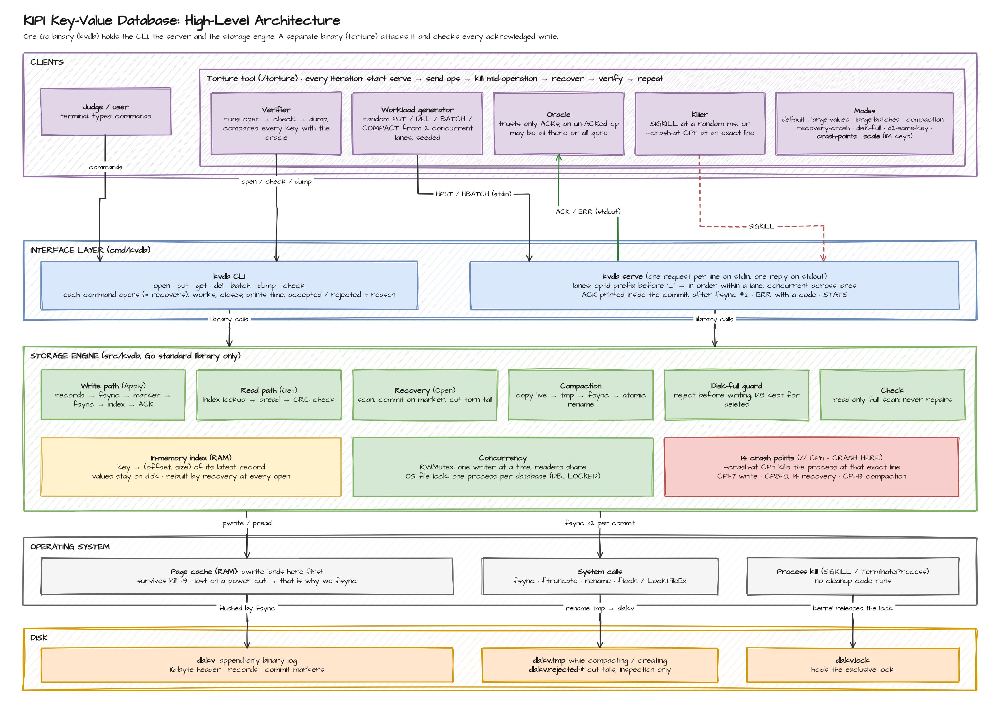
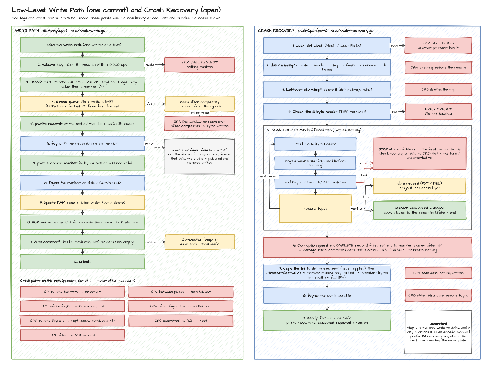
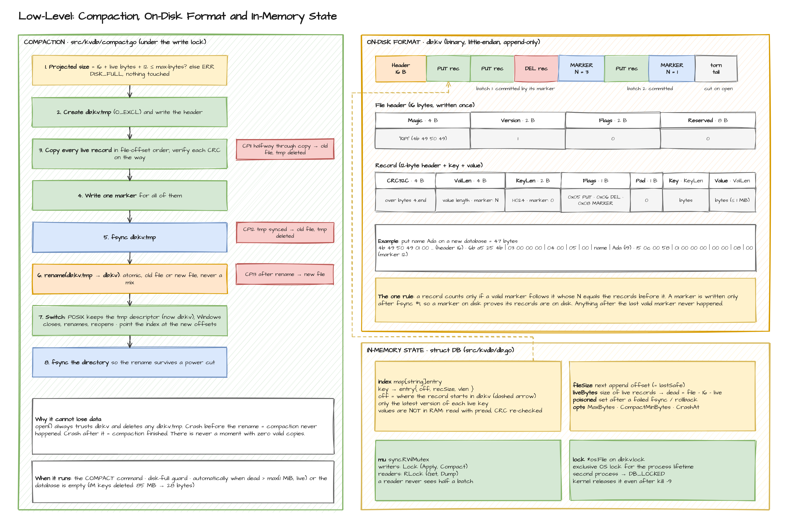
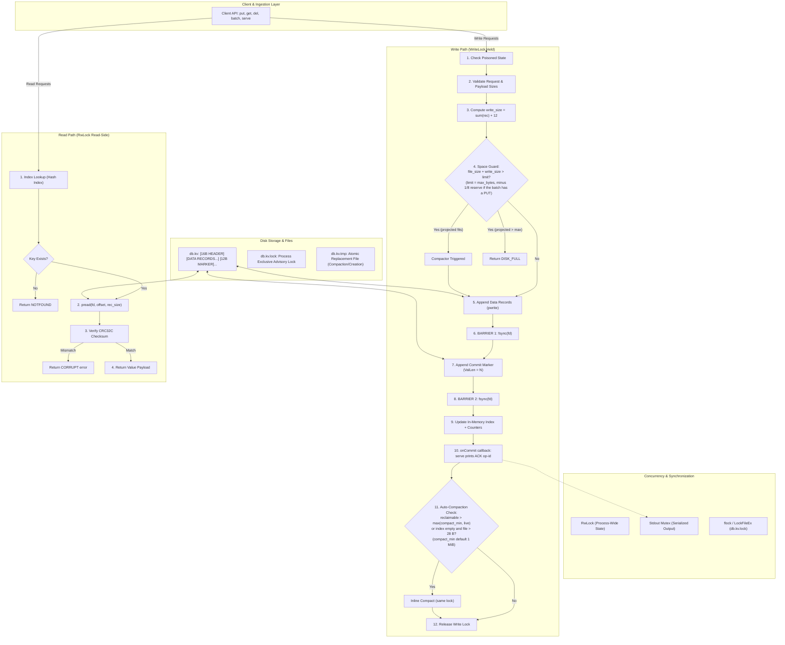

# KILL IT AND PROVE IT: ARCHITECTURE (v3.3)

Key-Value Database Storage Engine Architecture Specification. Every step number below matches a comment in the code (`src/kvdb/write.go` = §5, `compact.go` = §8, `recovery.go` = §9), and every row of the proof table in §12 names the command or test that verifies it.

---

## 1. Overview

* **Layout:** One authoritative data file, `db.kv`: 16-byte header + append-only log. Every commit (single operation or batch) terminates with a 12-byte commit marker.
* **Memory:** An in-memory hash index maps each live key to its record's file offset and size (`HashMap<key, {offset, rec_size, val_len}>`). Values are never cached in RAM; they are read directly from disk via `pread`.
* **Durability:** Two `fsync` barriers per commit. The in-memory index is updated only after the second barrier completes successfully, guaranteeing that memory never references data that is not durable on disk.
* **Concurrency:** A single process owns the file via an exclusive non-blocking file lock (`flock` on POSIX, `LockFileEx` on Windows). Within the process, an `RWMutex` serializes writers and allows concurrent `Get()` readers. `serve` prints each `ACK` from a callback that `Apply` runs after barrier 2, while the write lock is still held, so ACK order is commit order.
* **Recovery:** Takes the exclusive lock first, then performs a sequential scan from byte 16 staging records until a valid commit marker commits them. The torn or uncommitted tail after the last valid marker is truncated and fsynced. A damaged record *followed by* a valid marker is not a crash artifact, so recovery refuses with `CORRUPT` instead of truncating committed data.
* **Compaction:** Writes active (live) records to `db.kv.tmp`, fsyncs the temp file, and atomically renames it over `db.kv`. On POSIX systems, the open file descriptor of the temp file seamlessly becomes the database's live descriptor without reopening.

---

## 2. Architecture Diagram

The diagram is drawn in draw.io: source `diagrams/KIPI-architecture.drawio` (3 pages), images below so it opens offline. Page 1 shows every component and the locks; page 2 the numbered write ordering (1–12) and the recovery flow with every crash point; page 3 compaction, the on-disk layout with field sizes, and the in-memory index.





The same structure as a Mermaid flowchart (renders on GitHub):



### ASCII Reference Flow

```
                 +---------------------------------------------+
  stdin / API -->| Client API: put, get, del, batch, serve     |
                 +-------+----------------------------+--------+
                         | writes                     | reads
                         v                            v
   +----------------------------------+   +----------------------+
   | WRITE PATH (WriteLock)           |   | READ PATH (RwLock    |
   | 1  reject if poisoned            |   | read side)           |
   | 2  validate request              |   | index lookup         |
   | 3  compute write_size            |   | pread at offset      |
   | 4  space guard ------------------+-+ | verify CRC32C        |
   | 5  append data records           | | +----------+-----------+
   | 6  fsync    (BARRIER 1)          | |            |
   | 7  append commit marker          | |            |
   | 8  fsync    (BARRIER 2)          | |            |
   | 9  update index + counters       | |            |
   | 10 onCommit: serve prints ACK    | |            |
   | 11 auto-compaction check         | |            |
   | 12 release lock                  | |            |
   +----------------+-----------------+ |            |
                    |                   v            |
                    |      +----------------------+  |
                    |      | DISK-FULL GUARD      |  |
                    |      | + COMPACTOR          |  |
                    |      | (same lock, sec. 8)  |  |
                    |      +----------+-----------+  |
                    v                 v              v
   +---------------------------------------------------------+
   | IN-MEMORY INDEX: HashMap<key, {offset, rec_size, len}>  |
   +----------------------------+----------------------------+
                                v
   +---------------------------------------------------------+
   | FILE db.kv:  [HEADER 16 B][records ...][MARKER 12 B]... |
   | db.kv.lock:  flock held for process lifetime            |
   | db.kv.tmp:   exists only during compaction or creation  |
   +---------------------------------------------------------+

RECOVERY (open): Phase 0 lock and setup -> Phase 1 scan and stage
                 -> Phase 2 truncate -> Phase 3 ready

Write ordering: 1 append data records, 2 fsync (barrier 1), 3 append marker,
                4 fsync (barrier 2), 5 update index, 6 print ACK, 7 release lock
```

---

## 3. On-Disk Binary Format

A valid database file consists of a 16-byte fixed header, followed by zero or more committed transaction segments. Each segment consists of one or more data records followed immediately by a commit marker.

```
+---------------------------------------------------------------------------------------------------+
| File Header (16 B) | Record 1 (12B+K+V) | ... | Record N (12B+K+V) | Commit Marker (12 B, ValLen=N) |
+---------------------------------------------------------------------------------------------------+
```

### File Header (16 Bytes, Little-Endian)

| Offset | Size | Field | Expected Value | Purpose |
|:---|:---|:---|:---|:---|
| 0 | 4 B | `Magic` | `"KIPI"` (`0x4B495049`) | Identifies the file type |
| 4 | 2 B | `Version` | `0x0001` | Format version identifier |
| 6 | 2 B | `Flags` | `0x0000` | Reserved for future format flags |
| 8 | 8 B | `Reserved` | `0x0000000000000000` | Zeroed reservation padding |

### Record Header (12 Bytes, Little-Endian)

Every entry on disk (both data operations and commit markers) begins with this uniform 12-byte header:

| Offset | Size | Field | Meaning / Constraints |
|:---|:---|:---|:---|
| 0 | 4 B | `CRC32C` | Castagnoli CRC32 over bytes 4 through end of record (`ValLen`, `KeyLen`, `Flags`, `Pad`, `Key`, `Value`). |
| 4 | 4 B | `ValLen` | For `PUT`: `0 .. 1,048,576` (1 MiB).<br/>For `DEL`: `0`.<br/>For `COMMIT_MARKER`: op count `N` (`1 .. 10,000`). |
| 8 | 2 B | `KeyLen` | For `PUT` / `DEL`: `1 .. 1,024`.<br/>For `COMMIT_MARKER`: strictly `0`. |
| 10 | 1 B | `Flags` | Bitfield: `0x01` (PUT), `0x02` (DEL), `0x04` (BATCH_OP), `0x08` (COMMIT_MARKER). |
| 11 | 1 B | `Pad` | Strictly `0x00`. |

Followed immediately by:
* `Key` payload: `KeyLen` bytes.
* `Value` payload: `ValLen` bytes (for data records).
* Total record size on disk = `12 + KeyLen + ValLen`.

### Flag Rules

* **Data Records:** Must have `PUT | BATCH_OP` (`0x05`) or `DEL | BATCH_OP` (`0x06`). A standalone `put` or `del` is treated as a batch of size 1.
* **Commit Marker:** Exactly `COMMIT_MARKER` (`0x08`), with `KeyLen = 0` and `ValLen = N` (where $N$ is the number of operations in that commit).
* **Illegal Combinations:** Any flag combination not matching the above is immediately rejected during scanning as torn/corrupted data.

### Pre-Allocation Payload Validation Rules

To prevent maliciously or accidentally corrupted length fields from causing gigantic out-of-memory memory allocations:
1. `KeyLen` must be strictly between 1 and 1,024 for data records.
2. `ValLen` must be $\le 1\text{ MiB}$ ($1,048,576\text{ B}$) for `PUT`, and exactly 0 for `DEL`.
3. For a `COMMIT_MARKER`, `KeyLen` must be 0, and `ValLen` must equal the exact number of currently staged uncommitted records.
4. Total remaining bytes in the file must be $\ge 12 + \text{KeyLen} + \text{ValLen}$.

### Auxiliary Files

* **`db.kv.lock`**: An empty lock file held with an exclusive advisory lock (`flock` with `LOCK_EX | LOCK_NB` on Linux/macOS, `LockFileEx` on Windows) for the entire lifetime of the process. Because the OS kernel automatically releases advisory locks upon process termination (including `kill -9` or hard crashes), no stale locks can ever persist.
* **`db.kv.tmp`**: A temporary staging file created strictly during initial database creation or compaction. Deleted or replaced only during `Open()`, and exclusively *after* the process has secured the exclusive lock.

---

## 4. In-Memory State

From `src/kvdb/db.go`:

```go
type DB struct {
    path, tmpPath, lockPath string  // db.kv, db.kv.tmp, db.kv.lock
    opts      Options               // MaxBytes, CompactMinBytes, Trace, StepDelay, CrashAt
    lock      *os.File              // holds the OS file lock for the process lifetime

    mu        sync.RWMutex          // writers: Lock, readers: RLock
    f         *os.File              // open descriptor of db.kv
    index     map[string]entry      // live key -> location of its PUT record
    fileSize  int64                 // end of the last committed byte; the next append goes here
    liveBytes int64                 // sum of recSize over all indexed records
    poisoned  bool                  // set after a failed fsync or rollback; all writes refused
    closed    bool
}

type entry struct {
    off     int64  // file offset of the PUT record
    recSize uint32 // 12 + KeyLen + ValLen
    vlen    uint32 // value length
}
```

The output mutex and the per-lane request queues live in `cmd/kvdb/serve.go`, not in the engine: the engine knows nothing about stdout.

* **Reclaimable Space Calculation:**
  $$\text{reclaimable} = \text{fileSize} - 16 - \text{liveBytes}$$
  This represents superseded puts, tombstones (deletes), commit markers, and discarded data that can be recovered via compaction.

---

## 5. Write Protocol (`put`, `del`, `batch`)

All operations execute under the database write lock (`mu.Lock()`):

1. **Poison Check:** If `poisoned` is true, immediately reject with `IO_ERROR`.
2. **Request Validation:**
   - Keys must be $1 \le \text{len} \le 1,024$ bytes.
   - Values must be $0 \le \text{len} \le 1,048,576$ bytes.
   - Batch count must be $1 \le N \le 10,000$.
   - Any validation error returns `BAD_REQUEST` without modifying disk or memory.
3. **Compute Required Disk Footprint:**
   $$\text{write\_size} = \sum_{i=1}^N (12 + \text{KeyLen}_i + \text{ValLen}_i) + 12$$
   (The additional 12 bytes accounts for the commit marker).
4. **Disk-Full Space Guard:**
   The limit is `maxBytes` for a delete-only batch and `maxBytes − maxBytes/8` for a batch containing a PUT. The last 1/8 is a reserve so that a full database can always be emptied with deletes.
   If `maxBytes > 0` and `fileSize + write_size > limit`:
   - Compute projected compacted size:
     $$\text{projected} = 16 + \text{liveBytes} + 12$$
   - If $\text{projected} + \text{write\_size} \le \text{limit}$, invoke synchronous compaction (Section 8), then re-evaluate.
   - Otherwise, or if it still does not fit, return `DISK_FULL`. Not a single byte is written to disk.
5. **Append Data Records:**
   Write all data records sequentially with `pwrite` (Go `WriteAt`) starting at `fileSize`, in pieces of at most 256 KiB (this is where crash point CP2 sits).
   - *On write error:* Attempt to rollback by invoking `ftruncate(fd, fileSize)` followed by `fsync(fd)`. If rollback fails, mark database as `poisoned` and return `IO_ERROR`.
6. **BARRIER 1:** Invoke `fsync(fd)` (Go's `File.Sync`, which uses `fcntl(F_FULLFSYNC)` on macOS and `FlushFileBuffers` on Windows).
   - If fsync fails: mark database as `poisoned` and return `IO_ERROR`. Never retry fsync.
7. **Append Commit Marker:**
   Append the 12-byte commit marker (`ValLen = N`, `KeyLen = 0`, `Flags = COMMIT_MARKER`, valid CRC32C).
   - *On write error:* Rollback via `ftruncate(fd, fileSize)` and `fsync`. If rollback fails, poison.
8. **BARRIER 2:** Invoke `fsync(fd)`.
   - If fsync fails: mark database as `poisoned` and return `IO_ERROR`.
9. **Update In-Memory Index:**
   Apply operations in listed order:
   - For `PUT`: update `index[key]` with `{offset, rec_size, val_len}`.
   - For `DEL`: delete `key` from `index`.
   - Update `liveBytes` and update `fileSize += write_size`.
10. **Emit Acknowledgment:**
    `Apply(ops, onCommit)` calls `onCommit` here, still under the write lock. `serve` passes a callback that prints `ACK <op-id>` through its output mutex. This guarantees that emitted ACKs strictly follow disk commit order.
11. **Auto-Compaction Evaluation:**
    If $\text{reclaimable} > \max(\text{CompactMinBytes}, \text{liveBytes})$ (CompactMinBytes defaults to 1 MiB; `serve --compact-min-bytes N` changes it), **or** the index is empty and the file is larger than 28 bytes, run compaction inline under the lock. The first rule keeps the file under about 2 × live + 1 MiB, and each compaction copies no more bytes than were written since the last one, so the cost per write is constant. The second rule makes "delete everything" shrink the file to 28 bytes at once; compacting an empty database copies nothing. Failures during auto-compaction are logged but do not invalidate the already-committed write.
12. **Release Lock:** Release write lock (`mu.Unlock()`).

### Failure Handling Philosophy

* **Never retry a failed fsync:** After an I/O or page cache error, the OS kernel may discard dirty pages. A subsequent fsync retry could report false success while data has been dropped. We mark the engine poisoned, forcing an immediate restart so recovery can deterministically reconstruct the truth from disk.
* **Truncate on partial writes:** A failed append is rolled back to `fileSize`. If truncation fails, poison ensures no subsequent write builds on top of an unverified tail.

---

## 6. Batch Semantics

* **Sequential Application:** Operations within a batch are processed strictly in listed order.
* **Last-Write-Wins within Batch:**
  - `PUT X`, then `DEL X` $\to$ key $X$ is deleted/absent.
  - `DEL X`, then `PUT X` $\to$ key $X$ has the put value.
* **Atomic Markers:** A batch containing $N$ operations is followed by a single commit marker with `ValLen = N`. Crash recovery validates that exactly $N$ records precede the marker.
* **Reclaim Accounting:** If a batch replaces an existing live key, the old record's size is subtracted from `liveBytes`. If the same key is overwritten multiple times in a single batch, each intermediate version is accounted for as superseded.

---

## 7. Concurrency Model

* **Cross-Process Isolation:** Enforced via `flock(LOCK_EX | LOCK_NB)` on `<path>.lock`. A second process attempting to open the database fails immediately with `DB_LOCKED`.
* **Writers:** Operations (`put`, `del`, `batch`, compaction) acquire an exclusive write lock (`mu.Lock()`). Writers are completely serialized with respect to each other and readers.
* **Readers:** `get` acquires a shared read lock (`mu.RLock()`). Readers execute concurrently without blocking each other.
* **Atomic Snapshot Reads:** Because the index is only updated after Barrier 2, a reader either sees the entire batch or none of it—never a torn state.
* **Isolated Descriptor Reads:** `get()` uses `pread` at the indexed offset and re-verifies CRC32C before returning the value. Compaction swaps file descriptors under the write lock, so readers never experience descriptor invalidation.
* **Serve lanes:** `serve` reads requests on one goroutine and hands each to a **lane**, named by the op-id prefix before the first `_` (`w1_17` → lane `w1`). Each lane has its own goroutine and runs its requests in arrival order; different lanes run concurrently and genuinely contend for the write lock. Op-ids without `_` share one default lane, so hand-typed commands never reorder.
* **Deterministic Stdout Sequencing:** All `serve` output lines (`ACK`, `VAL`, `NOTFOUND`, `ERR`, `KV`) pass through a single mutex, so lines never interleave.

---

## 8. Compaction Protocol

Compaction rewrites all live keys to a fresh file and atomically replaces the active database file without closing or reopening descriptors (on POSIX systems). It runs on `COMPACT`, from the disk-full guard (§5 step 4) and from the auto-compaction check (§5 step 11).

```mermaid
sequenceDiagram
    autonumber
    participant Engine as Engine (Write Lock)
    participant Disk as Disk (Filesystem)
    participant Dir as Parent Directory

    Engine->>Disk: 1. Create db.kv.tmp (O_RDWR | O_CREAT | O_EXCL)
    Engine->>Disk: 2. Write 16B Header to tmp_fd
    loop For Each Live Key in Index
        Engine->>Disk: 3. pread from fd -> verify CRC -> buffered write to tmp_fd
    end
    Engine->>Disk: 4. Write Commit Marker (ValLen = live_count)
    Engine->>Disk: 5. fsync(tmp_fd)
    Engine->>Disk: 6. rename("db.kv.tmp", "db.kv") [Atomic]
    Note over Engine: 7. In-Memory Swap:<br/>old_fd = fd; fd = tmp_fd<br/>update index offsets<br/>close(old_fd)
    Engine->>Dir: 8. fsync(parent directory)
```

### Compaction Execution Steps

1. **Pre-check:** Calculate $\text{projected} = 16 + \text{liveBytes} + 12$. If `maxBytes > 0` and $\text{projected} > \text{maxBytes}$, abort compaction and leave `db.kv` untouched.
2. **Create Temporary File:** Create `db.kv.tmp` using `O_RDWR | O_CREAT | O_EXCL`. Write the standard 16-byte header. Retain descriptor as `tmp_fd`.
3. **Copy Live Records:** Iterate through all live entries in **file-offset order** (so the old file is read sequentially):
   - Read the record from `fd` using `pread`.
   - Verify its CRC32C and that it is a PUT for this key.
   - Copy it byte for byte to `tmp_fd` through a 4 MiB buffered writer. Records contain no offsets, so the bytes stay valid at their new position.
   - Record the new offset in a side table.
   - Crash point **CP11** is halfway through this loop.
4. **Append Final Commit Marker:** Write a commit marker with `ValLen = live_keys_count` at the end of `tmp_fd`.
5. **Sync Temporary File:** Invoke `fsync(tmp_fd)`. On failure: close `tmp_fd`, delete `db.kv.tmp`, and abort. `db.kv` remains unmodified and authoritative. Crash point **CP12** is right after this fsync.
6. **Atomic Rename:** Execute `rename("db.kv.tmp", "db.kv")`. On POSIX filesystems, this is an atomic metadata operation. Crash point **CP13** is right after it.
7. **In-Memory Descriptor & State Swap (Before Directory Sync):**
   - Save `old_fd = fd`, set active `fd = tmp_fd`, close `old_fd` (the old unlinked inode is freed by the kernel).
   - Update in-memory index offsets from the side table.
   - Set `fileSize = projected`. (`liveBytes` remains identical.)
8. **Sync Parent Directory:** Invoke `fsync` on the parent directory. If this fails, poison the engine; the rename is already committed on disk, and a restart will verify state.

> [!NOTE]
> **Windows Compatibility:** On Windows, `MoveFileEx` cannot overwrite a file that has open handles. Windows compaction closes both handles, renames, and reopens `db.kv`. A crash between the closes and the rename leaves the old `db.kv` and a complete `db.kv.tmp`; the next `open()` keeps `db.kv` and deletes the tmp. If the reopen fails, the engine is poisoned.

---

## 9. Crash Recovery Protocol (`Open`)

Recovery is idempotent: after any crash, including a crash during recovery itself, the next `open()` reaches the same clean, consistent state. Measured: 1,000,000 keys (85 MB file, killed mid-batch) recover in 486 ms (`./torture --mode scale`).

### Phase 0: Lock & Setup

1. **Acquire OS Lock:** Open or create `<path>.lock` and take an exclusive non-blocking lock (`flock`). If locked, fail immediately with `DB_LOCKED`.
2. **Missing Main File:** If `db.kv` does not exist:
   - Unlink any leftover `db.kv.tmp`.
   - Create `db.kv.tmp`, write the 16-byte header, fsync it, rename it to `db.kv`, and fsync the parent directory.
3. **Leftover Temp File:** If both `db.kv` and `db.kv.tmp` exist:
   - The main file `db.kv` is authoritative.
   - Unlink `db.kv.tmp` and fsync the parent directory.
4. **Header Validation:** Read the first 16 bytes of `db.kv`. Validate Magic (`"KIPI"`) and Version (`0x0001`). If invalid, fail with `CORRUPT` and do not touch the file (`TestBadHeaderIsHardError`).

Crash points: **CP8** while deleting a leftover tmp, **CP14** while creating a new database (tmp has its header, rename not done).

### Phase 1: Sequential Scan (8 MB Buffered Reader)

Initialize `last_safe = 16` and `staged = []`.

```
Loop from offset 16 to EOF:
  1. READ_HEADER:
     Attempt to read 12-byte record header.
     - Clean EOF at record boundary -> Exit scan loop cleanly.
     - Less than 12 bytes read -> Go to Phase 2 (TRUNCATE).

  2. VALIDATE:
     - Check Flag combinations.
     - Validate KeyLen and ValLen against bounds.
     - Ensure remaining bytes in file >= KeyLen + ValLen.
     - Read Key and Value payloads.
     - Recompute CRC32C over bytes [4..12+KeyLen+ValLen].
     - If any check fails -> CORRUPTION GUARD, then Phase 2 (TRUNCATE).

  2b. CORRUPTION GUARD (markerAfter):
     - If the failed record was COMPLETE (all its bytes are in the file) and a
       valid commit marker can be found after it, the damage is inside
       committed data, not a torn tail. Fail with CORRUPT; truncate nothing.
     - Otherwise it is the torn tail of a killed write: Go to Phase 2.

  3. STAGE:
     - If record is PUT or DEL:
       Append (op_type, key, offset, rec_size, val_len) to staged.

  4. COMMIT:
     - If record is COMMIT_MARKER:
       Check if staged.len() == marker.ValLen.
       - If mismatch -> Go to Phase 2 (TRUNCATE).
       - If match:
           Apply all staged operations to in-memory index in order.
           Update liveBytes.
           Clear staged list.
           Set last_safe = current_file_offset.
```

### Phase 2: Truncate Torn Tail

1. Discard all uncommitted elements remaining in `staged`.
2. If total file size $> \text{last\_safe}$:
   - Copy the bytes being cut into `db.kv.rejected-<offset>-<crc>` (written as `.part`, fsynced, renamed; best effort, never read back by the engine) so a person can see which un-ACKed writes were lost and resend them (`kvdb rejected`). Applying them would break atomicity (the batch may be partial) and could apply a retried write twice.
   - Call `ftruncate(fd, last_safe)`.
   - Call `fsync(fd)` immediately so the truncation survives any immediate crash.

Crash points: **CP9** after the scan (nothing written to `db.kv` yet), **CP10** after `ftruncate`, before its fsync. A crash while copying the rejected bytes leaves `db.kv` untouched and at most a `.part` file, which the next open deletes.

### Phase 3: Ready

- Set `fileSize = last_safe`.
- Calculate `reclaimable = fileSize - 16 - liveBytes`.
- Engine is ready to serve queries.

---

## 10. CLI & Serve Protocol Specification

The full reference with examples is in README §3 and §4. Summary:

### CLI Commands

```bash
./kvdb open  <path> [--max-bytes N] [--trace] [--crash-at CPn] [--step-delay-us N]
./kvdb put   <path> <key> <value>    # OK
./kvdb get   <path> <key>            # value, or NOTFOUND
./kvdb del   <path> <key>            # OK
./kvdb batch <path> <file>           # file of "put k v" / "del k" lines, applied atomically
./kvdb dump  <path>                  # key<TAB>value, ascending byte order
./kvdb check <path>                  # read-only: OK / OK (uncommitted tail ...) / CORRUPT ...
./kvdb serve <path> [--max-bytes N] [--compact-min-bytes N] [--step-delay-us N] [--crash-at CPn]
```

Every command opens the database (running recovery) and closes it on exit; there is no separate `close` command. `--crash-at CPn` makes the process kill itself at crash point CPn (BREAKING.md). `--step-delay-us N` sleeps between I/O steps without reordering them, so random kills land inside the windows.

### Serve Wire Protocol

One request per line on stdin, one reply per line on stdout. The op-id may come first or second (`PUT 1 k v` or `1 PUT k v`).

```
PUT   <op-id> <key> <value...>          HPUT   <op-id> <hexkey> <hexval|->
DEL   <op-id> <key>                     HDEL   <op-id> <hexkey>
GET   <op-id> <key>                     HGET   <op-id> <hexkey>
BATCH <op-id> <n>                       HBATCH <op-id> <n>
  n lines: "put key val" / "del key"      n lines: "HPUT hexkey hexval" / "HDEL hexkey"
COMPACT <op-id>    DUMP <op-id>    HELP    EXIT
```

Replies: `ACK <op-id>` (after barrier 2, under the write lock), `VAL` / `HVAL <op-id> <value>`, `NOTFOUND <op-id>`, `KV <op-id> <key> <value>` (DUMP), `ERR <op-id> <CODE> <detail>` with CODE one of `DISK_FULL`, `IO_ERROR`, `BAD_REQUEST`, `DB_LOCKED`, `CORRUPT`. If no op-id can be read: `ERR ? BAD_REQUEST ...`. A batch whose input ends before its n lines is rejected without an ACK, and serve stops.

---

## 11. Known Weaknesses & Constraints

1. **Larger Manual Truncation (F4 and beyond):** Cutting 1–4 bytes loses nothing: those are the marker's constant bytes (KeyLen 0, Flags 0x08, Pad 0), so recovery rebuilds the marker, verifies its CRC and count, and appends them. Cutting 5 or more bytes reaches the marker's count or CRC; recovery then cannot tell it from an uncommitted write and drops the last batch, even though it was acknowledged.
2. **Mid-File Corruption Is Refused, Not Repaired:** If a complete record fails its CRC and a valid marker follows it, recovery refuses with `CORRUPT` and leaves the file untouched rather than truncating acknowledged data (`TestCorruptionIsNotTruncated`). The database then needs manual repair; mid-file bit-rot repair is out of spec scope.
3. **No Directory Fsync on Windows:** Windows does not support directory fsyncs. A power cut between file rename and directory metadata flush could theoretically leave the directory entry unpersisted.
4. **Log Length Dependent Recovery Time:** Recovery time scales linearly with total log size. The auto-compaction threshold ($\text{reclaimable} > \max(64\text{ MiB}, \text{liveBytes})$) keeps log growth bounded to approximately $2 \times \text{live} + 64\text{ MiB}$.
5. **Write Stalls During Compaction:** Compaction runs under the exclusive write lock to guarantee consistency, temporarily blocking incoming writers.
6. **Single-Process Exclusivity:** Multi-process concurrency is prohibited by design; competing processes fail fast via `DB_LOCKED`.
7. **Physical Disk Headroom for Compaction:** Peak disk usage during compaction is approximately $\text{fileSize} + \text{projected}$. The `max_bytes` setting restricts logical database size, not transient physical disk allocation during compaction.
8. **Windows File Descriptor Reopen Hazard:** Windows `MoveFileEx` requires closing the open file handle before renaming, reintroducing a narrow window where a crash could occur while descriptors are closed.
9. **Directory Fsync Failure Poisons Engine:** A failure during directory sync following rename poisons the engine to force a safe restart.
10. **Power Loss Is Not Tested:** All tests kill the process, and the OS page cache survives a process kill. The two barriers and the directory fsync are what make power loss safe, but no test of ours cuts power (BREAKING.md §2–3).

---

## 12. Scenario-to-Mechanism Proof Table

"CPn" means `./torture --mode crash-points` (the real binary killed at that line) and the unit test `TestCrashPoints`. Torture numbers are from one of our runs with the seed shown; the same seed reproduces the same workload, and the counts move by a few percent between runs because kill timing depends on the disk.

| ID | Disk State at Kill | Mechanism | Code Location | Verified By |
|:---|:---|:---|:---|:---|
| **A1** | No record bytes written | Index changes only after barrier 2 | `write.go` Steps 1–4 | CP1; `TestTornTailEveryOffset` |
| **A2** | Partial record | Length / EOF / CRC check fails; TRUNCATE | `recovery.go` VALIDATE, Phase 2 | CP2; `TestTornTailEveryOffset` (every cut offset); default seed 12345: 108 tails cut |
| **A3** | Full record, no marker | Staged, never committed, cut | `recovery.go` STAGE, Phase 2 | CP3; `TestUncommittedBatchDiscarded` |
| **A4** | Marker and both fsyncs done, no ACK | Replay commits the op | `recovery.go` COMMIT | CP6; default seed 12345: 51 ops durable although un-ACKed, all accepted by the oracle |
| **A5** | Same as A4, ACK sent | Same as A4 | `recovery.go` COMMIT | CP7 (and CP1–CP6 check that no ACK was sent before durability); default seed 12345: 17,853 ACKed ops verified, 0 lost |
| **A6** | DEL record, with/without marker | Commit rule (as A3 or A4) | `recovery.go` STAGE, COMMIT | `TestTornTailEveryOffset` (delete case); default torture (DEL in the mix) |
| **A7** | 1 MB record, torn across blocks | Whole-record CRC32C / length check | `recovery.go` VALIDATE | CP2 (409,632-byte tail); large-values seed 999: 37 tails, 23.5 MB cut |
| **B1** | 3 of 10 records, no marker | No marker, discarded | `recovery.go` STAGE | CP2; `TestUncommittedBatchDiscarded` |
| **B2** | 10 records, no marker | No marker, discarded | `recovery.go` COMMIT | CP3, CP4; `TestUncommittedBatchDiscarded` (also wrong marker count) |
| **B3** | Barrier 1 done; marker partial or whole | Torn marker fails CRC; whole marker implies data on disk | `write.go` Steps 6–8 | CP5; `TestTornTailEveryOffset` |
| **B4** | All 10 committed | Replay applies all ops | `recovery.go` COMMIT | `TestBatchAtomicityAndMaximumSize`; large-batches seed 5: 100/100 |
| **B5** | put X, del X in one batch | Listed-order application (Sec. 6) | `write.go` Step 9, `recovery.go` COMMIT | `TestBatchOrdering` |
| **B6** | Half of 10,000 records, no marker | Discarded; scan is linear | `recovery.go` Phase 1 | large-batches seed 5: batch in flight at 99/100 kills, 31 tails / 13.5 MB cut; scale: 10,000-key batch killed, all or nothing |
| **C1** | Killed during open, pre-truncate | Recovery writes nothing before TRUNCATE | `recovery.go` Phase 1 | CP9; recovery-crash seed 42: open killed during scan 102× |
| **C2** | Killed during truncate | Idempotent; fsync after ftruncate | `recovery.go` Phase 2 | CP10; recovery-crash seed 42: killed during truncate 40× |
| **C3** | Tmp partial, main intact | Tmp unlinked at open, after lock; main authoritative | `compact.go` Steps 2–5, `recovery.go` Phase 0 | CP8, CP11, CP12; `TestCompactionShrinks`; compaction seed 7: 26 leftover tmps cleaned |
| **C4** | Killed during rename | Rename is atomic; tmp_fd becomes live fd, no reopen | `compact.go` Steps 6–7 | CP13; CP7b (a write after compaction lands in the new file); compaction seed 7: 1,419 compactions, 100/100 |
| **C5** | After rename, before dir fsync | Swap done first; dir fsync failure poisons; file complete | `compact.go` Steps 7–8, `recovery.go` Phase 0 | CP13 (file 1,439 → 72 bytes, all data present) |
| **C6** | Killed during close | `Close` only closes the descriptor and releases the lock; it writes nothing | `db.go` Close | code review; `TestLargeValueRepeatedOpenAndClose` |
| **D1** | Two writers, different keys | Serialized; ACK printed under lock so ACK order = commit order | `write.go` Steps 1, 10 | `TestConcurrentWriters`; every torture mode runs 2 concurrent lanes |
| **D2** | Two writers, same key | Serialized; last commit wins | `write.go` Steps 1, 10 | `TestConcurrentWriters`; d2-same-key seed 11: 100/100 |
| **D3** | Long batch plus single puts | Serialized; batch atomic via marker | `write.go` | large-batches (2 lanes) seed 5: 100/100 |
| **D4** | get during batch | RwLock; index changes only under write lock | `db.go` Get, `write.go` Step 9 | `TestReaderNeverSeesHalfBatch` |
| **E1** | Cap reached, single put | Pre-check rejects before any write | `write.go` Step 4 | `TestDiskFull`; disk-full seed 3: 5,343 `DISK_FULL` replies |
| **E2** | Cap reached mid-batch | Whole batch size checked up front | `write.go` Step 4 | `TestDiskFull`; disk-full |
| **E3** | Cap reached, then kill | Rejection writes nothing | `write.go` Step 4 | disk-full seed 3: file size checked after every kill, max 229,267 of 262,144 bytes |
| **E4** | Cap reached during compaction | projected > max_bytes aborts; tmp unlinked on failure | `compact.go` Steps 1, 5–6 | `TestCompactionOverCap` |
| **E5** | Deletes freed space | projected + write_size <= limit; 1/8 reserve for deletes | `write.go` Step 4 | `TestDiskFull`; disk-full seed 3: 6,087 ACKs after a `DISK_FULL` |
| **F1** | Repeated kills | All mechanisms above | Torture loop | default seed 12345: 200/200, op in flight at 198 of 200 kills |
| **F2** | Kills during recovery | Idempotent scan and truncate | `recovery.go` Phases 1–2 | recovery-crash seed 42: 100/100 |
| **F3** | 1M keys, killed, reopened | Linear scan; log bounded by compaction | `recovery.go`, `compact.go` trigger | `./torture --mode scale`: 1,000,001 keys in 403–483 ms; 85,001,250 → 28 bytes after deleting every key, with no `COMPACT` sent (auto-compaction); `TestDeleteEverythingShrinks` |
| **F4** | Last 1 byte cut by hand: the final marker is missing its Pad byte | Marker's last 4 bytes are constants: rebuilt, CRC and count verified, missing bytes appended; nothing lost (Weakness 1 for longer cuts) | `recovery.go` `scan` (torn-header branch), `Open` Phase 2b | `TestTruncateOneByte` (cuts of 1–6 bytes); `TestTornTailEveryOffset` |

**The tool can fail.** A `-tags sabotage` build plants one bug at a time (`ack-before-fsync`, `no-truncate`, `no-marker`, `compact-old-fd`). `./torture --mode crash-points` fails on each of them on every run, in under a second; the random modes catch each within 1 to 20 iterations (README §9).

---

## 13. The Three Guarantees

### 1. Durability
> **An ACK prints only after barrier 2 returns and the index is updated.**
> Barrier 1 guarantees that all data records are physically durable on disk before the commit marker is appended; Barrier 2 guarantees that the commit marker is physically durable on disk. Thus, the presence of a valid commit marker on disk strictly implies that all corresponding payload records are also durable on disk. Because recovery replays only completely committed data, every acknowledged operation survives a process crash (tested: all 14 crash points, thousands of random kills) and is designed to survive power loss (argued in BREAKING.md §2, not tested).

### 2. Atomicity
> **A batch's records are sealed by a single marker carrying the exact op count.**
> Recovery applies a batch if and only if it discovers a valid marker whose `ValLen` matches the exact number of staged records. Without this valid marker, the entire batch is discarded. Concurrently, readers access the database through shared read locks, and the index is only updated under the exclusive write lock after Barrier 2. Consequently, readers and recovered databases never observe partial batches.

### 3. Recoverability
> **`Open()` writes nothing during its scan, and truncation shrinks only to a known valid prefix.**
> Recovery is idempotent: Phase 1 is strictly read-only. Phase 2 shrinks the file exclusively to `last_safe` (a point validated by a commit marker and CRC) and immediately calls `fsync`. Compaction writes to an independent temporary file and executes an atomic rename. The next `Open()` cleans up any residual temporary files only after obtaining the exclusive lock. Every state produced by any abrupt termination is a valid input state for `Open()`.

---

## 14. Verification Status

| Target | Status |
|:---|:---|
| 1,000,000 keys recover in < 2 s | 486 ms, wall time of the `./kvdb open` process (`./torture --mode scale --seed 5`) |
| File shrinks after deletes | 85,001,250 → 28 bytes (header + one marker) after deleting every key, by auto-compaction alone (no `COMPACT` command) |
| Every crash point behaves as documented | 15/15 cases at the 14 crash points (`./torture --mode crash-points`), 14/14 in `TestCrashPoints` |
| Oracle trusts only ACKs, hex dialect, bit-exact | yes: every value carries an envelope with key, op-id, sequence and CRC (`cmd/torture/oracle.go`) |
| Windows | builds and vets with `GOOS=windows`; close-rename-reopen path in `platform_windows.go`; not torture-tested by us |
