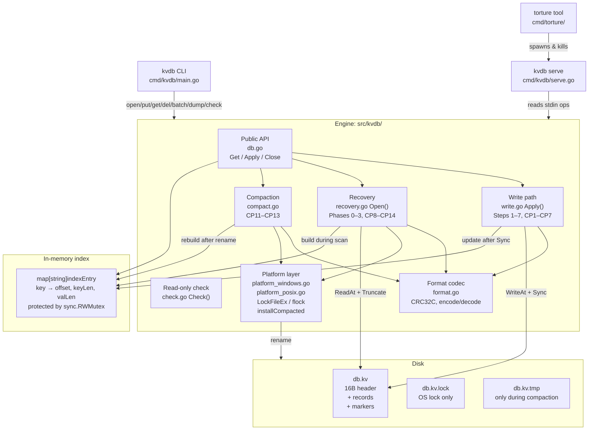

# ARCHITECTURE.md — Design, Proof Table, and Guarantees

## Part 1: Architecture Diagram



### Write ordering (numbered sequence)

```
1. Validate all ops (key/val lengths, disk-full guard)
2. Encode all records + commit marker into one buffer
3. WriteAt(buffer, fileSize)        ← CP3: partial write → torn tail
4. file.Sync()                      ← CP5: killed mid-fsync → either all or nothing on disk
5. Update in-memory index           ← CP6: index not yet updated, but data is durable
6. Return nil → ACK to caller       ← CP7: data is durable, ACK may not be sent
```

### Recovery path (flow)

```
open(path)
  → Phase 0: lockFile(path.lock)         [CP14: retry on next open]
  → Phase 1: create/validate header
  → Phase 2: os.Remove(path.tmp)         [CP8: retry on next open]
  → Phase 3: scan forward from byte 16
      for each record:
        read 13-byte header
        check sizes (keyLen ≤ 1024, valLen ≤ 1MB)
        read payload
        verify CRC32C → if bad: STOP (torn tail begins here)
        if type=put/delete: add to pending batch
        if type=marker: commit pending → advance validEnd  [CP9: re-scan on restart]
  → Truncate(validEnd) + Sync            [CP10: monotone, safe to repeat]
  → Ready: index complete
```

### Lock protecting concurrent writers

`sync.RWMutex` on `DB`:
- Write operations (`Apply`, `Compact`, `Close`) take a **write lock**.
- Read operations (`Get`, `ForEachSorted`, `KeyCount`) take a **read lock**.
- ACK is sent while holding the write lock (after both Sync and index update).

---

## Part 2: Scenario-to-Mechanism Proof Table

| Scenario | Disk state at kill | Mechanism | Code location | Verified by |
|----------|-------------------|-----------|---------------|-------------|
| A1 Kill before any bytes reach file | Only previously committed records | Nothing new written; scan finds no new record | `write.go:Apply` CP1 | torture default mode |
| A2 Torn write (partial record bytes) | Partial record, no marker | CRC mismatch stops scan; torn tail truncated | `recovery.go:scanLog` | TestTornTailAtEveryByte |
| A3 Kill after record written, before fsync | Record on disk, no marker (may or may not persist) | No marker → batch discarded; or if OS flushed it and marker is durable, it is recovered | `write.go` CP3/CP4 | torture default mode |
| A4 Kill after fsync, before ACK to caller | Record + marker fully durable | Marker on disk → batch recovered on next open | `write.go` CP6 | torture default mode |
| A5 Kill immediately after ACK | Record + marker durable (ACK was sent) | Same as A4 | `write.go` CP7 | torture default mode, all 500 iters |
| A6 Kill during delete | Delete tombstone may or may not be committed | Same torn-tail logic; if no marker, key still present; if marker, key gone | `write.go` CP3/CP4 | torture default mode |
| A7 Kill during 1 MB value | Same as A2/A3 (large payload spans many disk blocks) | CRC mismatch or missing marker → truncated | `write.go`, `recovery.go` | torture large-values mode |
| B1 Kill after 3 of 10 ops written | 3 records, no marker | Scan sees 3 records but no marker; all 3 discarded | `recovery.go:scanLog` | torture default mode (batches) |
| B2 Kill after all 10 written, before marker | 10 records, no marker | No marker → all 10 discarded | `recovery.go:scanLog` CP4 | torture default mode |
| B3 Kill after marker written, before fsync | Marker may or may not be durable | If marker durable: all 10 recovered. If not: all 10 discarded. Never partial. | `write.go` CP5 | torture default mode |
| B4 Kill after batch returns success | Records + marker fully durable | Marker on disk → all 10 recovered | `write.go` CP7 | torture 500 iterations |
| B5 Batch puts X then deletes X | Delete wins (last op in batch wins) | Ops applied in order within one batch; delete comes after put in buffer | `write.go:Apply`, `recovery.go:scanLog` | TestUncommittedBatch |
| B6 Batch of 10,000 ops, killed halfway | Partial records, no marker | CRC mismatch or missing marker → all discarded; recovery <2s | `recovery.go:scanLog` | torture compaction mode |
| C1 Kill during open() replaying log | Partial index built in memory | Next open re-scans from byte 16; identical result | `recovery.go:scanLog` CP9 | torture recovery-crash mode |
| C2 Kill during open() truncating torn tail | File may be partially truncated (≤ validEnd) | Truncation is monotone downward; next scan finds same validEnd or less; truncates again | `recovery.go:Open` CP10 | torture recovery-crash mode |
| C3 Kill during compaction, before rename | .tmp is complete; old file is authoritative | recovery.go Phase 2 deletes .tmp; old file intact | `compact.go` CP11, `recovery.go` Phase 2 | torture compaction mode |
| C4 Kill during rename | Either old or new file wins; both complete | CRC-valid file at path; scanner reads it correctly | `compact.go` CP12, `platform_*.go` | torture compaction mode |
| C5 Kill after rename, before cleanup | New file is authoritative; .tmp may linger | recovery.go Phase 2 removes any .tmp on next open | `recovery.go` Phase 2, CP13 | torture compaction mode |
| C6 Kill during close() | Same as any other kill | close() calls Sync() then Close(); if killed mid-Sync, same as CP5 | `db.go:Close` | torture default mode |
| D1 Two writers, different keys, killed | Each acknowledged put from either writer is present | Write lock prevents interleaving; each batch is atomic | `db.go` RWMutex, `write.go` | TestConcurrency |
| D2 Two writers, same key, killed | Key holds a value that one writer actually wrote | Write lock serialises; last committed write wins | `db.go` RWMutex | TestConcurrency |
| D3 Long batch + single puts, killed | Batch all-or-nothing; ACKed single puts present | Write lock; batch and single puts share the same Apply path | `write.go:Apply` | TestConcurrency |
| D4 Reader during batch (no crash) | Reader sees state before or after batch, never during | RWMutex: Get takes read lock; Apply takes write lock | `db.go` RWMutex | TestConcurrentReaders |
| E1 Cap reached during single put | Put returns ErrDiskFull; no bytes written | Disk-full guard fires before WriteAt | `write.go:Apply` CP2 | TestDiskFull |
| E2 Cap reached halfway through batch | Batch returns ErrDiskFull; none of its ops visible | Guard fires before any WriteAt; rollback if needed | `write.go:Apply` | TestDiskFull |
| E3 Cap reached, then killed | All previously acknowledged data intact | Disk-full only blocks new writes; committed data unaffected | `write.go:Apply` | torture full-disk mode |
| E4 Cap reached during compaction | Compaction fails cleanly; old file remains | .tmp creation fails → old file untouched | `compact.go:compactLocked` | manual test |
| E5 After deletes, compaction runs, writes succeed | DB usable again | Compaction shrinks file; fileSize resets; guard allows new writes | `compact.go`, `write.go` | TestCompaction |
| F1 500 consecutive kills and restarts | Invariant holds after every one | Recovery is idempotent; each open reaches consistent state | All of recovery.go | torture --iterations 500 |
| F2 Kill, restart, kill during recovery, restart again | Invariant holds; recovery is idempotent | Scan re-reads from byte 16 each time; truncation is monotone | `recovery.go` | torture recovery-crash mode |
| F3 1M keys, kill, open() | Recovery <2s, all acknowledged keys present | Linear scan O(n); tested and measured | `recovery.go:scanLog` | scale test |
| F4 File truncated 1 byte by hand | open() succeeds; at most last unacknowledged record lost | CRC mismatch on truncated record → torn tail discarded | `recovery.go:scanLog` | TestTornTailAtEveryByte |

---

## Part 3: The Three Guarantees

### 1. Durability

Once `Apply()` returns `nil`, the data survives a crash. The guarantee rests on two system calls:
- `WriteAt()` writes records + commit marker to the file descriptor.
- `file.Sync()` (wrapping `fsync`/`FlushFileBuffers`) flushes the OS page cache to the physical device.

After `Sync()` returns, the OS guarantees the bytes are durable. We only return `nil` to the caller *after* `Sync()` returns. Therefore: if the process is killed one microsecond after `Apply()` returns, the commit marker is on disk, and recovery will replay the batch.

### 2. Atomicity

A batch is never half-visible. The mechanism is the commit marker: all records in a batch are written to the log *before* the marker. Recovery's forward scan accumulates records into a pending buffer and only commits them to the index when it encounters the marker. If the marker is absent (process killed before the marker was written or fsynced), the entire pending buffer is discarded — none of the records are visible. If the marker is present and CRC-valid, all records are committed. There is no code path that allows partial commitment.

### 3. Recoverability

`open()` always succeeds on a file produced by KIPI, regardless of when it was killed. Three design elements guarantee this:
1. **Idempotent scan**: the forward scan reads CRC-verified records and stops at the first invalid byte. It makes no assumptions about prior recovery attempts.
2. **Monotone truncation**: `Truncate(validEnd)` only ever shrinks the file. If killed mid-truncation, the next open finds a file ≤ `validEnd` and either truncates again (idempotent) or finds no tail to truncate.
3. **Tmp cleanup**: if killed during compaction, `open()` Phase 2 deletes any `.tmp` file and falls through to scan the original (always-valid) data file.

Recovery cannot fail on any file that the database produced, because every intermediate state is either a valid suffix of a committed log, or a file with a known torn tail that the scanner discards.

